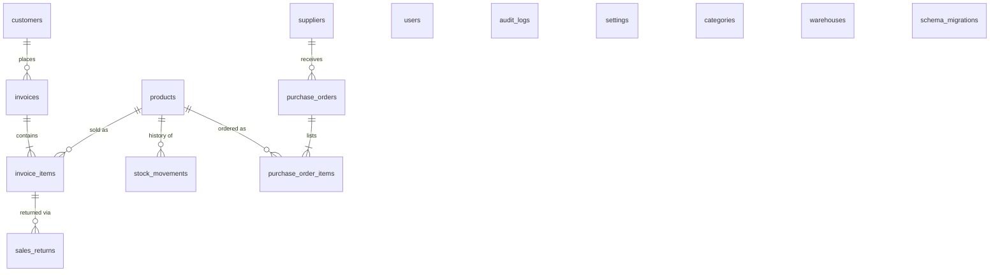

# Architecture

## Layers

```mermaid
flowchart TD
    UI["ui/ (Tkinter windows)"] --> SVC["services/ (business rules)"]
    SVC --> DB["db/ (connection, schema, migrations, upgrades)"]
    SVC --> PERM["permissions.py (who may do what)"]
    DB --> SQLITE[("SQLite file")]
```



* `ui/` only collects input and shows results. It never contains SQL or pricing rules.
* `services/` holds every rule. Each function takes the connection and a `Session`, checks the permission,
  and runs inside one transaction. They raise `errors.POSError` subclasses that the UI turns into dialogs.
* `db/` owns the schema (`schema.py`), pragmas/transactions (`connection.py`), the upgrade of the original
  database (`migrations.py`) and numbered upgrades (`upgrades.py`).

## Folder map

| Path | Purpose |
|---|---|
| `inventory_app.py` | Launcher (`python3 inventory_app.py`); also `python3 -m pos_erp` |
| `pos_erp/config.py` | Paths, limits, payment methods, categories (some values come from the database at start-up) |
| `pos_erp/money.py` | Integer-cent helpers (parse, allocate, format) |
| `pos_erp/security.py` | scrypt hashing, legacy SHA-256 verification |
| `pos_erp/permissions.py` | Role -> permission map and `Session` |
| `pos_erp/dayrange.py` | Date presets and half-open timestamp bounds for reports |
| `pos_erp/services/*` | auth, user, inventory, stock ledger, sales, till, returns, purchase, customer, reporting, dashboard, settings, lists, backup, print, receipt, audit |
| `pos_erp/ui/*` | Main window, POS tab, inventory tab, dashboard tab, login, dialogs |
| `scripts/seed_demo.py` | Builds a separate demo database through the real services |
| `tests/` | unittest suite (services, migrations, UI smoke tests, demo data) |

## Data model



## Key decisions

1. **Integer cents.** Floats drift (0.1 + 0.2). All money columns are `*_cents INTEGER`.
2. **Invoices keep snapshots.** `invoice_items` store product name, unit price and unit cost at the time of sale,
   so editing or deleting a product never rewrites history, and profit uses the real cost.
3. **One door for stock.** `stock_service.apply_stock_change` is the only code that modifies `products.stock`
   and it always writes a ledger row. The DB also rejects negative stock (`CHECK stock >= 0`).
4. **Atomic operations.** Checkout, returns, receiving and imports run in one transaction (nested calls use
   savepoints). A failure leaves no half-finished data.
5. **Soft delete.** Products and suppliers are deactivated, not removed, so foreign keys stay valid.
6. **Permissions live in services.** Hiding a button is only a convenience; `session.require(...)` is the rule.
7. **Migrations.** `PRAGMA user_version` tracks the base schema. The legacy upgrade backs up the file first and
   runs in a single transaction; IDs are preserved.
8. **Upgrades after the base schema.** Later changes are numbered functions in `db/upgrades.py`, recorded in
   `schema_migrations`; a file backup is taken before they run.
9. **No default accounts.** A brand-new database asks for the administrator account at first start.
10. **Voids reuse the ledger.** Voiding an invoice returns stock with reason `RETURN` and a `VOID ...` note, so the
    `stock_movements` CHECK constraint stays unchanged. The invoice keeps its history (`status = 'Voided'`).
11. **Cash tendering wraps checkout.** `till_service.checkout_with_payment` runs `sales_service.checkout` and the
    payment update in one transaction (nested savepoint), so an insufficient payment rolls the whole sale back.
12. **Points are a discount.** Redeemed loyalty points are added to the invoice discount before tax; the points and
    their value are also stored on the invoice so a void can restore them.
13. **Reorder suggestions are derived, never stored.** `purchase_service.reorder_suggestions` computes them from
    stock, minimum alerts and open purchase orders each time, so they can never go stale.
14. **Demo data uses the real services.** `scripts/seed_demo.py` sets the clock back and calls the same functions
    the UI calls, so demo data obeys the same rules as real data and can never leave stock and ledger out of step.
15. **Recovery keys, not a reset button.** A forgot-password screen must prove who you are, so each user can hold a
    random 80-bit recovery key, stored only as a scrypt hash, single-use and rotated after use. The no-proof
    emergency reset is a command-line tool, because running it already requires access to the database file.
## Permissions

| Permission | Admin | Cashier |
|---|:--:|:--:|
| sales.create, invoices.view, customers.lookup, inventory.view, barcode.generate, account.update | yes | yes |
| returns.process, sales.void | yes | no |
| inventory.manage / import / export | yes | no |
| stock.view / stock.adjust | yes | no |
| purchasing.manage | yes | no |
| reports.view, analytics.view, audit.view, customers.view | yes | no |
| users.manage, settings.manage, lists.manage, system.backup, system.restore | yes | no |

## Running the tests

```bash
python3 -m unittest discover -s tests -t . -v
```

The UI smoke tests open real (hidden) Tk windows and are skipped when no display is available.

## Manual QA checklist (after UI changes)

1. New database: the first-run screen creates the administrator; log in.
2. Inventory tab: add a product, edit its stock (reason required), see it in the Stock Ledger; sort a column, use a filter.
3. POS tab: add items by barcode and by ID, apply discount and tax, enter cash received (change due shows), Process Bill, export or print the receipt.
4. Customer: look up a phone number, open the history, redeem a point on the next sale.
5. Recent Invoices: reopen a receipt, void an invoice (reason) and check stock and Net Revenue.
6. Return / Refund: look up an invoice, refund 1 unit, confirm stock and Net Revenue change.
7. Suppliers -> Purchase Orders: create an order (also via "From Low Stock"), receive part of it, then the rest.
8. Reports: run This month, export CSV; check Low Stock, Expiry and Stock Value tabs; open the Dashboard tab.
9. Import CSV: a bad file is rejected with row numbers; a good file shows a preview first.
10. Log in as a cashier: restricted buttons are greyed out, no Dashboard tab.
11. Settings > Backup & Restore: Create Backup, Health Check.
12. Close the app: a new file appears in `backups/`.

## Not in scope yet

Per-warehouse stock and batch tracking (FEFO), real barcode rendering, per-category tax, split payments, hold/resume
carts, multi-terminal use (needs a server database) and an installer/packaging.